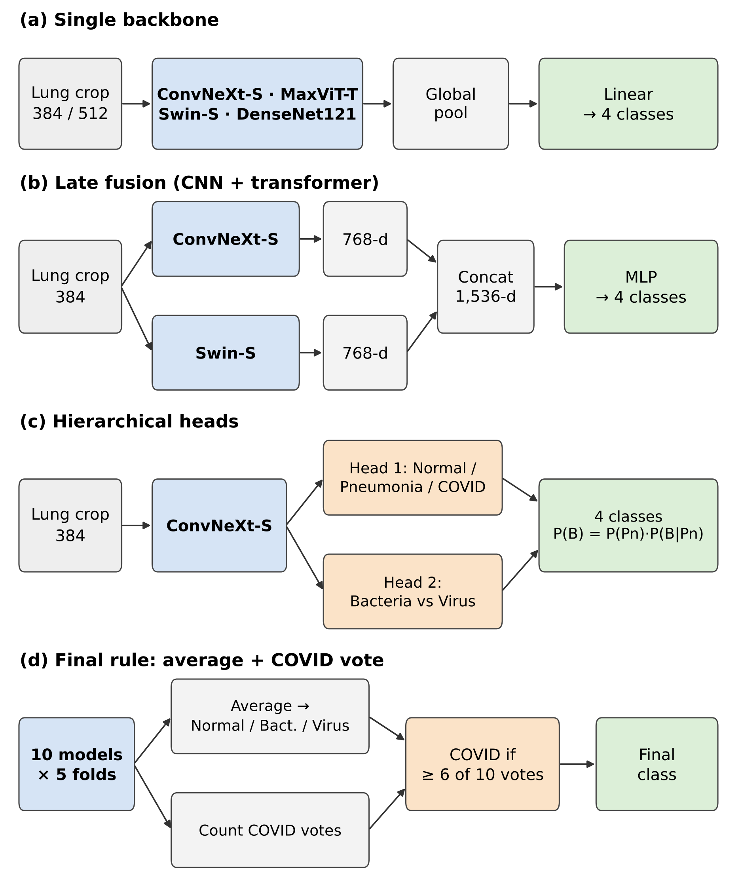
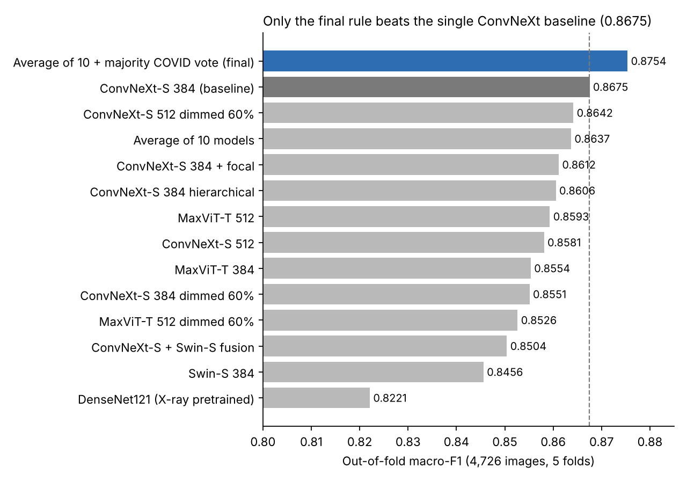

# CXR Multi-Class Classification (NYCU AIMI 2026, Lab 3)

Four-class chest X-ray classification (**Normal / Bacteria / Virus / COVID-19**), scored by **macro-F1** on Kaggle.
Student: 315551006, Shem Lawalata (劉天恩).

Pipeline: lung-region crop with a pretrained segmentation network → CLAHE + mild augmentation → 5-fold training of
several ImageNet-pretrained backbones (ConvNeXt-S, MaxViT-T, Swin-S, X-ray-pretrained DenseNet121, plus fusion and
hierarchical variants) → final rule: average of 10 models, COVID-19 decided by majority vote.



## Results

Out-of-fold (OOF) macro-F1 is computed on all 4,726 labelled images (train + val, 5 folds); the public leaderboard
uses the 1,182 test images.

| Model / rule | OOF macro-F1 | Public leaderboard |
| --- | --- | --- |
| ConvNeXt-S 384, folds 0, 3, 4, tuned offsets | 0.8726 (3 folds) | **0.87311** |
| ConvNeXt-S 384, 5 folds, tuned offsets | 0.8691 | 0.86374 |
| Equal-weight ensemble of 5 models | 0.8702 | 0.86491 |
| 10-model average + majority COVID-19 vote | **0.8754** | 0.86307 |

Per-model OOF results, every experiment and the discussion are in the report (`LAB3_315551006_Shem Lawalata.pdf`,
submitted to E3).



## Repository

| File | What it does |
| --- | --- |
| `preprocess_lungcrop.py` | Lung segmentation (TorchXRayVision PSPNet) → lung / mirror / centre crop → 512-px crops + `manifest.csv` + debug overlays. Options: `--sample N` trial run, `--redo`, `--mask_only --mask_outside 0.6` (dim outside the chest), `--full_image` (no-crop baseline). |
| `cxr_data.py` | Dataset, CLAHE, augmentation, label loading from the competition CSVs, Mixup, `write_submission()` (one-hot, template order). |
| `train.py` | k-fold training of one model (timm backbones, `xrv_densenet121`, `fusion`, `hier`), AMP, EMA, resumable checkpoints; `--finalize` = OOF report, offset tuning, nested check, submissions. |
| `analyze.py` | Confusion matrices, learning curves, bacteria/virus overlap, error galleries, Grad-CAM, metadata shortcut probe, COVID-like negatives. |
| `ensemble.py` | Combines finished runs (equal / searched weights + offsets) with a nested check. |
| `vote_ensemble.py` | Final rule: average of runs + majority vote for COVID-19 → submission. |
| `experiments/` | Round-3 decision-rule experiments (`final_submit.py`, `covid_verify.py`) and report figures (`report_figures.py`). |
| `notebooks/` | Kaggle notebooks (2 × T4) for rounds 2–5; each writes the scripts it used, trains two folds per GPU in parallel and zips the results. |
| `docs/` | Figures used in this README. |

## Setup

```bash
pip install -r requirements.txt
```

Data layout (from the Kaggle competition, `kaggle competitions download -c nycu-aimi-2026-lab3-cxr`):

```
data/
  train_images/  val_images/  test_images/
  train_data.csv  val_data.csv
test_data_sample.csv          # submission template provided by the TA
```

## How to run

```bash
# 1. Lung crops (once; ~15 min on a T4). Check the contact sheet first with --sample 60.
python preprocess_lungcrop.py --data_root data --out_root processed_data

# 2. Train one model, all folds (or --fold 0, --fold 1,2 ...; reruns resume)
python train.py --proc_root processed_data --data_root data --work_dir work \
                --run_name convnext_s_384 --fold all

# 3. Out-of-fold report + submissions for that run
python train.py --proc_root processed_data --data_root data --work_dir work \
                --run_name convnext_s_384 --finalize --template_csv test_data_sample.csv

# 4. Analysis figures (Grad-CAM, error galleries, shortcut checks)
python analyze.py --work_dir work --proc_root processed_data --run convnext_s_384

# 5. Final rule over all finished runs
python vote_ensemble.py --work_dir work --runs all --n_folds 5 \
                        --template_csv test_data_sample.csv --out submission.csv
```

Other models used in the report (same folds):

| Run | Extra arguments for `train.py` |
| --- | --- |
| ConvNeXt-S 384 (baseline) | defaults (`convnext_small.fb_in22k_ft_in1k_384`, 15 epochs) |
| ConvNeXt-S 512 | `--img_size 512 --batch_size 12 --accum 2 --epochs 12` |
| ConvNeXt-S focal / hierarchical | `--focal_gamma 2 --epochs 12` / `--model hier --epochs 12` |
| MaxViT-T 384 / 512 | `--model maxvit_tiny_tf_384.in1k --batch_size 12 --accum 2 --epochs 12` / `--model maxvit_tiny_tf_512.in1k --img_size 512 --batch_size 6 --accum 4 --epochs 12` |
| Swin-S 384 | `--model swin_small_patch4_window7_224.ms_in22k_ft_in1k --batch_size 12 --accum 2 --lr 5e-5 --epochs 12` |
| DenseNet121 (X-ray pretrained) | `--model xrv_densenet121 --lr 3e-4 --epochs 12` |
| Late fusion ConvNeXt-S + Swin-S | `--model fusion --batch_size 8 --accum 3 --lr 5e-5 --epochs 12` |
| Dimmed-input runs | train on `--proc_root processed_dim60`, made with `preprocess_lungcrop.py --data_root processed_data --out_root processed_dim60 --mask_only --mask_outside 0.6` |

Shared recipe: AdamW (weight decay 0.05, head LR × 10), 1-epoch warm-up + cosine, label smoothing 0.1,
COVID-19 × 5 oversampling, drop path 0.2, EMA 0.999, mixed precision, best epoch by validation macro-F1.

## Notes

- Hardware: Google Colab T4 (round 1) and Kaggle 2 × T4 (rounds 2–5); about 40 GPU-hours in total.
- On Kaggle, store the API token as a notebook secret (`KAGGLE_API_TOKEN`), never in a cell.
- **Use of AI tools:** an AI assistant (Claude, Anthropic) helped write and debug this code, design and analyse the
  experiments, write the report and draw the architecture figure. All runs were executed by the author on Colab and
  Kaggle.

## References

- Liu et al., *A ConvNet for the 2020s* (ConvNeXt), CVPR 2022
- Liu et al., *Swin Transformer*, ICCV 2021
- Tu et al., *MaxViT: Multi-Axis Vision Transformer*, ECCV 2022
- Cohen et al., *TorchXRayVision*, MIDL 2022
- Selvaraju et al., *Grad-CAM*, ICCV 2017
- Lin et al., *Focal Loss*, ICCV 2017
- [timm](https://github.com/huggingface/pytorch-image-models)
